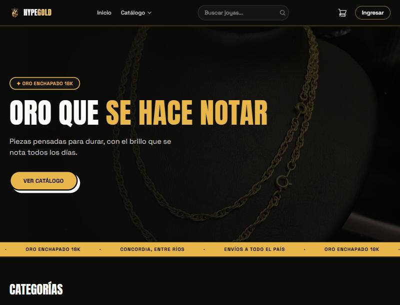
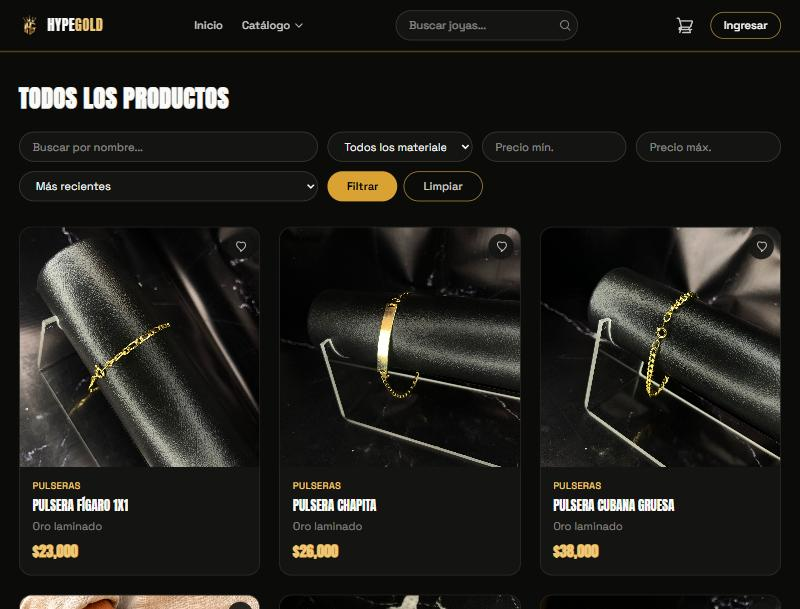
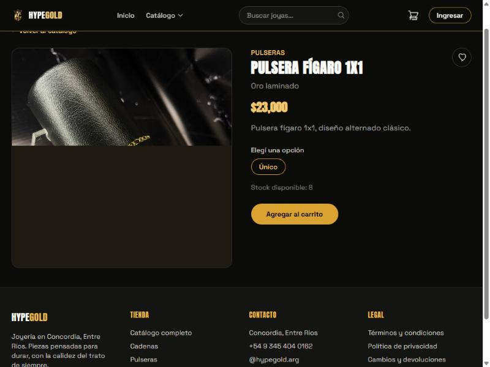
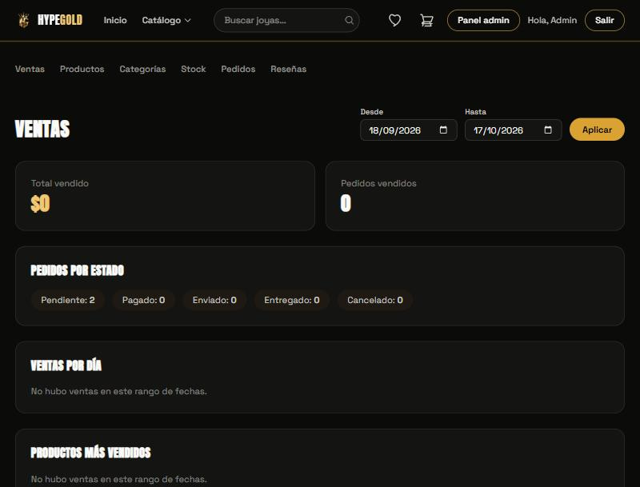

<div align="center">


### [](https://git.io/typing-svg)

Tienda online de joyería en enchapado de oro 18k — proyecto full-stack de e-commerce, de punta a punta: catálogo, carrito, checkout con Mercado Pago, panel de administración y despliegue real.

[](https://laravel.com)
[](https://angular.dev)
[](https://www.typescriptlang.org)
[](https://tailwindcss.com)
[](https://www.php.net)
[](https://www.mercadopago.com.ar/developers)

**[🌐 Ver demo en vivo](https://hype-gold-eccomerce-web.vercel.app)** · **[📑 Documentación de la API](https://hypegold-eccomerce-web.onrender.com/api/documentation)**

</div>

> [!NOTE]
> Es un proyecto de portfolio desplegado en hosting gratuito (Vercel + Render) — la primera carga del día puede tardar unos segundos mientras el backend "despierta". Mercado Pago queda en modo sandbox, así que no se procesan pagos reales.

---

## 📸 Capturas

<table>
  <tr>
    <td width="50%"></td>
    <td width="50%"></td>
  </tr>
  <tr>
    <td width="50%"></td>
    <td width="50%"></td>
  </tr>
</table>

## ✨ Funcionalidades

**Tienda**
- Catálogo con filtros (categoría, material, precio) y buscador con autocompletado
- Detalle de producto con variantes (talle/medida) y stock en tiempo real
- Carrito, favoritos, cupones de descuento
- Checkout con pago vía Mercado Pago (Checkout Pro) y webhook de confirmación
- Cuenta de usuario: direcciones, historial de pedidos, comprobante de compra
- Reseñas de productos

**Panel de administración**
- Dashboard de ventas con filtros por fecha
- ABM de productos (con variantes e imágenes), categorías y cupones
- Gestión de stock y de pedidos (cambios de estado con notificación por email)
- Buscador en los listados de productos, pedidos, categorías y stock

## 🛠 Stack

| | |
|---|---|
| **Backend** | Laravel 12 · PHP 8.2+ · Laravel Sanctum · MySQL / PostgreSQL · L5-Swagger |
| **Frontend** | Angular 22 (standalone + signals) · Tailwind CSS 4 · Vitest |
| **Pagos** | Mercado Pago (Checkout Pro) |
| **Deploy** | Vercel (frontend) · Render (backend + Postgres) — [ver guía](DEPLOY.md) |
| **Gestión** | Jira (proyecto `HG`) |

## 📂 Estructura del repositorio

```
├── backend/    # API REST en Laravel 12 + Sanctum + Swagger
├── frontend/   # SPA en Angular + Tailwind CSS
└── docs/       # Documentación del proyecto (presentación, capturas)
```

## ⚙️ Puesta en marcha

### Backend

```bash
cd backend
composer install
cp .env.example .env
php artisan key:generate
php artisan migrate --seed
php artisan serve
```

La documentación de la API queda disponible en `http://localhost:8000/api/documentation`.

`php artisan migrate --seed` crea dos usuarios de prueba (solo para desarrollo local):

| Rol | Email | Contraseña |
|---|---|---|
| Administrador | `admin@hypegold.com` | `password` |
| Cliente | `cliente@hypegold.com` | `password` |

### Frontend

```bash
cd frontend
npm install
ng serve
```

La app queda disponible en `http://localhost:4200`.

## ☁️ Deploy

El sitio se puede desplegar gratis (como demo) en Vercel (frontend) + Render (backend). Guía paso a paso en [`DEPLOY.md`](DEPLOY.md).

## 🌳 Convenciones de Git

- **Ramas:** `main` (estable), `develop` (integración), `feature/HG-123-descripcion-corta`, `fix/HG-123-descripcion-corta`.
- **Commits:** Conventional Commits + clave de Jira. Ejemplo: `feat(catalogo): agregar filtros por material [HG-19]`.

## 📄 Documentación

El documento de presentación del proyecto está en [`docs/HypeGold-Presentacion-del-Proyecto.docx`](docs/HypeGold-Presentacion-del-Proyecto.docx).

## 📋 Gestión del proyecto

El backlog completo (épicas, historias y subtareas) está en Jira, proyecto **HG** en `hypegold.atlassian.net`.

---

<div align="center">

Hecho en Concordia, Entre Ríos 🇦🇷

</div>
